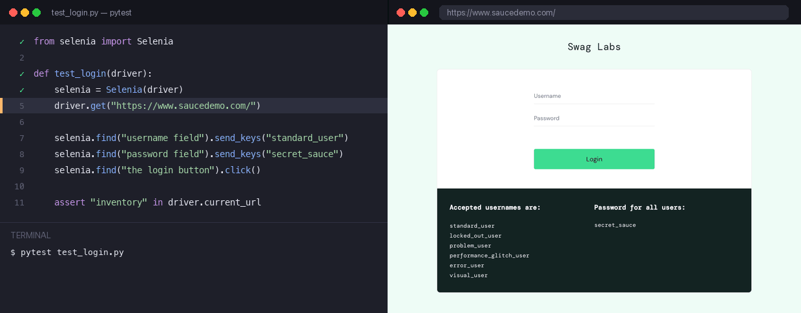

# Selenia

[](https://pypi.org/project/selenia/)
[](https://pypi.org/project/selenia/)
[](https://github.com/penielny/selenia/actions/workflows/tests.yml)
[](https://pepy.tech/project/selenia)
[](LICENSE)

**Stop maintaining brittle XPath. Find Selenium elements with plain English, using a 24 MB model
that runs locally. No LLM, no API key, no per-call cost.**

<p align="center">
  
</p>
<p align="center"><sub>A real run: every element is chosen by the model from the page's own elements.</sub></p>

| | |
|---|---|
| 🎯 **89% top-1 / 96% top-3** | on websites the model never saw during training |
| ⚡ **~20–35 ms per `find`** | on a laptop CPU (Apple M1), after a one-time 0.4 s model load |
| 🔒 **100% local** | nothing leaves your machine; works offline and in locked-down CI |
| 🛑 **Never guesses** | raises when nothing fits, or when two elements fit equally well |

---

## Why Selenia?

Locators break whenever the front end changes: a renamed class, a moved `div`, a regenerated id.
LLM browser agents can avoid that, but they need an API key, send your pages to a third party, cost
money on every step, take seconds per action, and can confidently pick the wrong element.

Selenia does one job: it turns a description into an element. A small fine-tuned ranking model
scores the **real elements on the page** against your description and returns the best one. It
never writes a selector, so it cannot invent one.

| | Selenia | LLM agents (browser-use, Stagehand, Skyvern…) | Hand-written XPath / CSS |
|---|---|---|---|
| Survives UI refactors | ✅ | ✅ | ❌ |
| Runs offline, no API key | ✅ | ❌ (unless you host an LLM) | ✅ |
| Cost per step | $0 | API tokens | $0 |
| Latency per element | tens of ms | seconds | ms |
| Same page + same description → same element | ✅ | ❌ | ✅ |
| Refuses ambiguous matches | ✅ | ❌ | n/a |
| Plans multi-step tasks on its own | ❌ | ✅ | ❌ |

If you want an autonomous agent, use an agent. If you want reliable, fast, free locators inside the
Selenium tests you already have, use Selenia.

## 📦 Installation
```bash
pip install selenia
```
Or from source:
```bash
pip install .
```

## 🛠️ Usage
```python
from selenium import webdriver
from selenia import Selenia

driver = webdriver.Chrome()
selenia = Selenia(driver)   # downloads the model on first use

driver.get("https://www.saucedemo.com/")
selenia.find("username field").send_keys("standard_user")
selenia.find("password field").send_keys("secret_sauce")
selenia.find("the login button").click()

# Find all matching elements, best match first
buttons = selenia.find_all("add to cart button")
```

`find` returns a normal Selenium `WebElement`, so it works alongside your existing code, waits and
page objects. Elements inside open shadow DOM are found too.

More runnable scripts, including a full checkout flow, error handling and a pytest suite, are in
[examples/](examples/README.md).

## 🎯 How matches are chosen
- `find` raises Selenium's `NoSuchElementException` when the model is not confident (`min_score`,
  default 0.5) or when two elements fit equally well (`min_margin`, default 0.05). The message
  names the candidates, so you can see what to add to the description.
- `find_all` returns every element scoring at least `min_score`, best first.
- Tune both with `LocalRanker(min_score=..., min_margin=...)`; `min_margin=0` always takes the top pick.
- iframes are not searched: switch into the frame first, then call `find`.

## 🧩 The model
A cross-encoder (based on `ms-marco-MiniLM-L-6-v2`) fine-tuned on about 28,800 description/element
pairs collected from real websites, then exported to int8 ONNX. It runs on `onnxruntime` and
`tokenizers`, so there is no PyTorch dependency.

| Held-out evaluation (161 queries, sites unseen in training) | top-1 | top-3 | MRR |
|---|---|---|---|
| Base model, before fine-tuning | 82.6% | 93.8% | 0.890 |
| **Selenia, shipped int8 ONNX model** | **89.4%** | **96.3%** | **0.933** |

The first time you create a `Selenia`, it downloads the model (about 24 MB) into `~/.cache/selenia`
and verifies its checksum. After that it runs offline.

- `SELENIA_CACHE_DIR` changes where the download is kept.
- `SELENIA_MODEL_URL` fetches from your own mirror instead of the GitHub release.
- To use a model you trained yourself, pass `LocalRanker(model_dir="training/models/selenia-ce")`
  or set `SELENIA_MODEL_DIR`. That is the folder written by `training/train.py`.

### Train it on your own app
The full pipeline that produced the model (collecting pages, labelling, generating descriptions,
fine-tuning, int8 export and evaluation) is in [training/](training/README.md). Retraining on
screens from your own product is the fastest way to push accuracy higher for your tests.

## 🧪 Running Tests
```bash
python -m pytest tests/
```
The tests in `tests/test_browser.py` drive a headless Chrome against a local page and are skipped
when Chrome cannot start. The ones that use the real model are also skipped unless a trained model
is at `training/models/selenia-ce` or `SELENIA_MODEL_DIR`.

## 🤝 Contributing
Issues and pull requests are welcome. Especially useful: pages where Selenia picks the wrong
element (open an issue with the URL and your description), so they can be added to the training
and evaluation data.

If Selenia saves you from fixing a broken locator, a ⭐ helps other people find it.

## 📄 License
[MIT](LICENSE)

---

Made with ❤️ by Penielny
